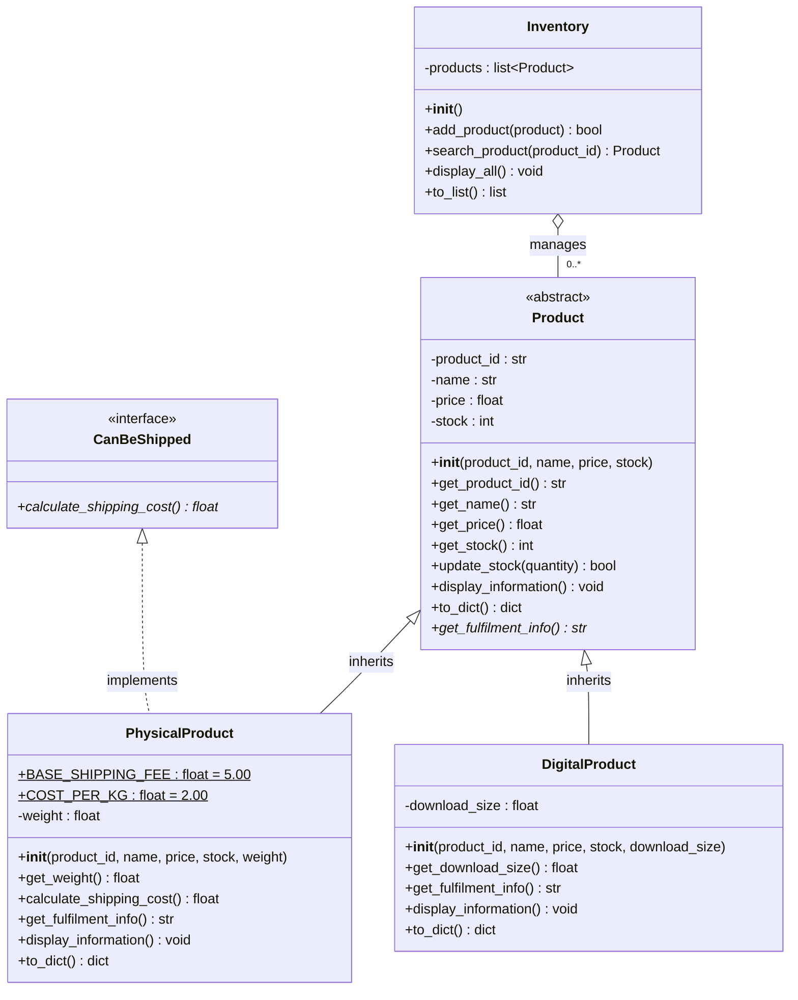

# Lab 7 – UML Class Diagram (Inventory Management System)

## Notation key

| Notation | Meaning |
|----------|---------|
| `<<abstract>>` | Abstract class – cannot be instantiated (`Product` inherits `ABC`) |
| `<<interface>>` | Interface-style abstract base class (`CanBeShipped`) |
| Method ending in `*` (shown in *italics*) | Abstract method (`@abstractmethod`, no implementation) |
| Solid line, hollow triangle → parent | Inheritance / generalisation (`PhysicalProduct` and `DigitalProduct` **is-a** `Product`) |
| Dashed line, hollow triangle → interface | Interface realisation (`PhysicalProduct` **can-be-shipped**) |
| Hollow diamond on `Inventory` | `Inventory` holds 0..* `Product` objects |
| `-` / `+` | Private (`__attribute`) / public |
| Underlined attribute | Class (static) attribute |

## Notes
- `PhysicalProduct` and `DigitalProduct` **override** `display_information()` and `to_dict()`, calling the parent version with `super()` first, and **implement** the abstract `get_fulfilment_info()`.
- `DigitalProduct` does **not** realise `CanBeShipped`, so it has no `calculate_shipping_cost()`.
- `PhysicalProduct` has single class inheritance (`Product`) plus one interface (`CanBeShipped`).
- The module-level functions (`create_default_inventory`, `product_from_dict`, `load_inventory`, `save_inventory` and the menu functions) are not classes, so they are not shown.
