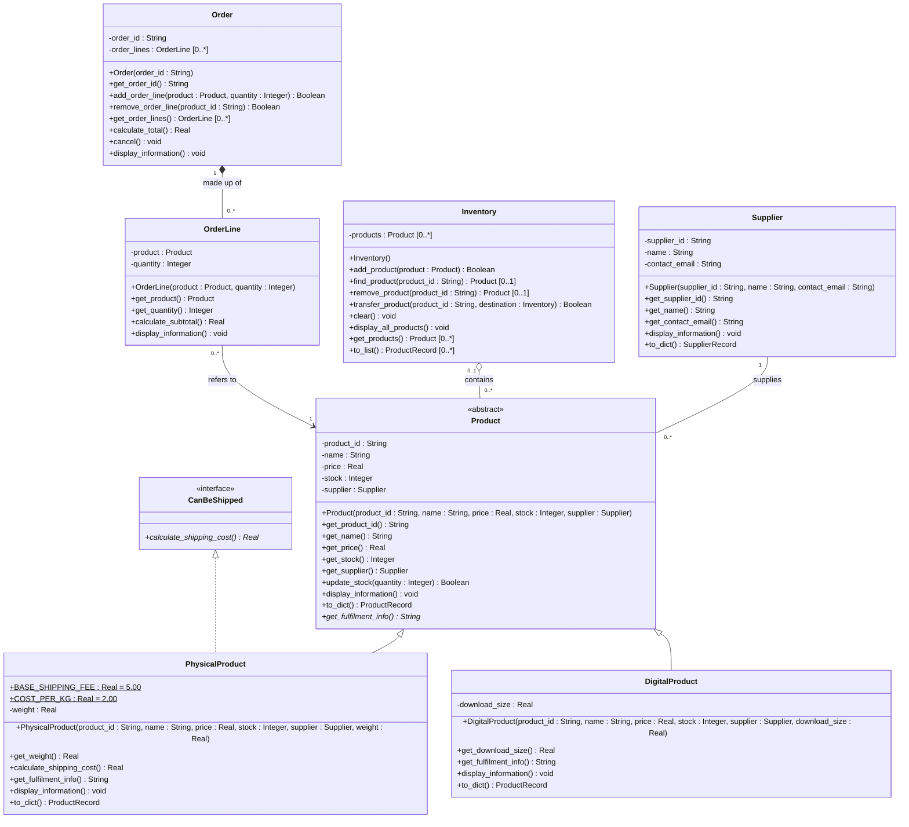

# Lab 8 – UML Class Diagram (Inventory Management System)

## Relationships

| Relationship | Notation | Multiplicity | Why this relationship |
|---|---|---|---|
| `PhysicalProduct`, `DigitalProduct` → `Product` | Inheritance: solid line, hollow triangle at the parent | – | Each subclass **is-a** `Product` and can be used wherever a `Product` is expected (LSP). |
| `PhysicalProduct` → `CanBeShipped` | Realisation: dashed line, hollow triangle at the interface | – | Only physical products **can be shipped**, so `DigitalProduct` does not implement it. |
| `Supplier` — `Product` | **Association**: plain solid line | `Supplier 1` — `0..* Product` | The Product only **knows about** its Supplier. Neither is part of the other, and both exist independently. The Supplier is created first and passed into the Product's constructor. |
| `Inventory` ◇— `Product` | **Aggregation**: hollow diamond at the whole (`Inventory`) | `Inventory 0..1` ◇— `0..* Product` | The Inventory is a whole made of Products, but it **does not create or own** them. A Product exists before it is added, can be removed or transferred to another Inventory, and is not destroyed. The `0` means a Product can be in no Inventory at all. |
| `Order` ◆— `OrderLine` | **Composition**: filled diamond at the whole (`Order`) | `Order 1` ◆— `0..* OrderLine` | The Order **creates** its OrderLines inside `add_order_line()`. Each OrderLine belongs to exactly one Order, is never transferred, and is removed when the Order is cancelled. |
| `OrderLine` → `Product` | **Association**: solid line (arrow shows OrderLine knows Product) | `0..* OrderLine` → `1 Product` | An OrderLine refers to a Product but does not own it. The same Product can be in many OrderLines and in an Inventory. |

## Types

The diagram uses language-independent UML types, so it would make sense in Java or C# as well as Python:

| UML type | Python type hint |
|---|---|
| `String` | `str` |
| `Integer` | `int` |
| `Real` | `float` |
| `Boolean` | `bool` |
| `void` | `None` (no value returned) |
| `Product [0..*]` | `list[Product]` |
| `OrderLine [0..*]` | `list[OrderLine]` |
| `Product [0..1]` (zero or one result) | `Product \| None` |
| `SupplierRecord`, `ProductRecord` | `TypedDict` records (key–value maps) used to save to and load from JSON |

## Notation key

| Notation | Meaning |
|---|---|
| `<<abstract>>` | Abstract class: cannot be instantiated (`Product` inherits `ABC`) |
| `<<interface>>` | Interface-style abstract base class (`CanBeShipped`) |
| Method ending in `*` (shown in *italics*) | Abstract method (`@abstractmethod`, no implementation) |
| `-` / `+` | Private (`__attribute`) / public |
| Underlined attribute | Class (static) attribute |
| `[0..*]`, `[0..1]` | Multiplicity: any number / zero or one |

## Notes
- `PhysicalProduct` and `DigitalProduct` **override** `display_information()` and `to_dict()` (calling the parent version with `super()` first) and **implement** the abstract `get_fulfilment_info()`. Neither overrides `update_stock()`, so both keep the behaviour `Product` promises.
- `supplier : Supplier` and `product : Product` are **stored references, but not aggregation or composition**. There is no whole–part relationship, so they are drawn as associations.
- The module-level functions (`create_default_inventory`, `product_from_dict`, `supplier_from_dict`, `load_inventory`, `save_inventory` and the menu functions) are not classes, so they are not shown.
